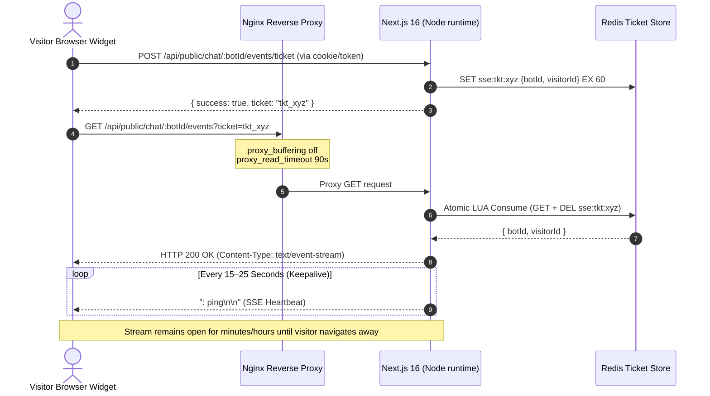

# EMPEROR NEXUS — STAGE 3 REAL-TIME SSE PERFORMANCE & CONCURRENCY TEST PLAN

**Document ID:** `STAGE-3-SSE-PLAN-001`  
**Date:** November 20, 2026  
**Auditor / Performance Engineer:** Antigravity Autonomous Performance & SRE Engineer  
**Baseline Git Commit:** `639b621`  
**Target Endpoints:** `/api/public/chat/[botId]/events` & `/api/realtime`  
**Status:** SPECIFICATION APPROVED FOR ISOLATED TESTING

---

## 1. ARCHITECTURAL CLARIFICATION: SSE TICKETS VS. STREAM DURATION

A critical architectural distinction must guide all SSE performance testing:

> **The 60-Second TTL on SSE Tickets is NOT a Connection Lifetime.**  
> - **The Ticket (`tkt_*`)**: An ephemeral, single-use authentication token generated via `POST /api/public/chat/[botId]/events/ticket`. It has a 60-second expiration window purely to prevent credentials from lingering in browser history, proxy URLs, or access logs (SEC-02). It is consumed atomically via Redis GET + DEL upon stream connection.  
> - **The Established Stream**: Once the ticket is redeemed, the HTTP connection upgrades to an **indefinitely persistent Server-Sent Events stream (`text/event-stream`)**. The connection remains open as long as the visitor stays on the website, maintained by periodic heartbeat comments (`: ping\n\n` every 15–30 seconds).

---

## 2. SSE ARCHITECTURE & DATA FLOW



---

## 3. SSE TEST DIMENSIONS & METRIC TARGETS

| # | Test Dimension | Test Scenario | Acceptance Criteria & Safety Limits |
| :---: | :--- | :--- | :--- |
| **1** | **Ticket Exchange & Redemption** | 100 rapid sequential ticket issuances and redemptions; simulated replay attempts. | 100% redemption success on first call; 0% replay success on duplicate call (SEC-02-B). Latency $< 15\text{ms}$. |
| **2** | **Idle Connection Memory** | Maintain 10, 25, 50, 100 concurrent idle EventSource connections for 15 minutes. | Node.js heap memory growth $< 30\text{ KB}$ per idle connection. Total memory for 100 idle streams $< 5\text{ MB}$. |
| **3** | **Active Streaming Memory** | Trigger concurrent AI token streams across 10, 20, 30 active sessions. | Chunk delivery TTFT $< 250\text{ms}$. No socket buffer ballooning. Memory recovers immediately after stream closes. |
| **4** | **Connection Longevity & Heartbeats** | Sustain 20 streams continuously for 30 minutes. | Zero unexpected drops. Periodic `: ping\n\n` comments keep Nginx `proxy_read_timeout 90s` from closing sockets. |
| **5** | **Client Disconnect Handling** | Forcefully terminate 50 client connections mid-stream (TCP RST/FIN simulation). | Node.js detects client abort via `request.signal.aborted`. Stream controller closes cleanly; active locks released. |
| **6** | **Nginx Buffer Saturation** | Send high-frequency token bursts (50 tokens/sec) through Nginx. | Zero chunk buffering or packet aggregation (`X-Accel-Buffering: no` verified). Tokens stream progressively to client. |
| **7** | **Reconnection & Token Renewal** | Simulate transient network drops and automatic EventSource reconnects. | Client automatically re-requests a fresh ticket and resumes stream without user intervention or tenant leakage. |

---

## 4. DETAILED BENCHMARK SCRIPTS & EXECUTION METHODOLOGY

### 4.1 Node.js Synthetic SSE Concurrency Client (`tests/load/sseConcurrencyClient.js`)
We will utilize a specialized asynchronous EventSource load runner based on standard Node.js `undici` / `http` client that:
1. Provisions synthetic visitor sessions and acquires ephemeral tickets.
2. Connects to `http://127.0.0.1:3301/api/public/chat/[botId]/events?ticket=[tkt]`.
3. Monitors parser latency, heartbeat intervals, and memory footprint.
4. Simulates sudden disconnects and measures backend garbage collection.

```javascript
// Test harness outline:
async function simulateSseClient({ botId, durationMs = 60000 }) {
  // Step 1: Obtain ticket
  const ticketRes = await fetch(`http://127.0.0.1:3301/api/public/chat/${botId}/events/ticket`, {
    method: "POST",
    headers: { "Content-Type": "application/json" },
    body: JSON.stringify({ visitorToken: "vis_test_stage3" })
  });
  const { ticket } = await ticketRes.json();

  // Step 2: Establish long-lived EventSource stream
  const sseRes = await fetch(`http://127.0.0.1:3301/api/public/chat/${botId}/events?ticket=${ticket}`);
  const reader = sseRes.body.getReader();
  
  // Step 3: Stream reading loop with heartbeat tracking
  // ...
}
```

---

## 5. NGINX INGRESS SSE SAFETY CONTROLS

The following configuration parameters in `nginx/emperornexus.com.conf` protect the VPS from socket exhaustion during high SSE connection counts:
1. `proxy_buffering off;` — Prevents Nginx from accumulating token buffers in memory.
2. `proxy_set_header X-Accel-Buffering no;` — Disables FastCGI/proxy micro-buffering.
3. `proxy_read_timeout 90s;` — Closes dead connections if no ping is received within 90s.
4. `keepalive 32;` — Multiplexes upstream connections to Next.js, eliminating TCP handshake overhead.
5. `limit_conn emperor_nexus_conn 40;` — Protects the host by limiting single-IP flooding to 40 simultaneous streams.
