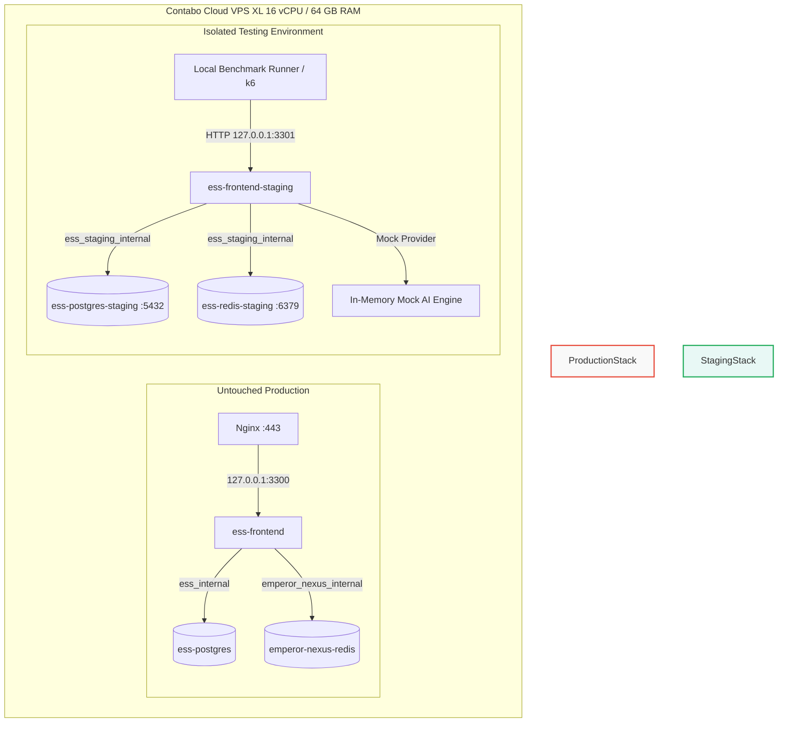

# EMPEROR NEXUS — STAGE 3 TEST ENVIRONMENT & ISOLATION REPORT

**Document ID:** `STAGE-3-TEST-ENV-001`  
**Date:** November 20, 2026  
**Auditor / Lead SRE:** Antigravity Autonomous Performance & SRE Engineer  
**Baseline Git Commit:** `639b621`  
**Target Environment:** Isolated Staging Stack (`docker-compose.staging.yml`)  
**Status:** PROPOSED & PREPARED (Awaiting User Review before Launch)

---

## 1. EXECUTIVE SUMMARY & ISOLATION MANDATE

To adhere strictly to **Non-Negotiable Safety Rules 1, 2, 3, 8, and 9**, performance and load testing must **never** be executed directly against production databases, live Redis queues, production customer records, or active public endpoints.

This report establishes the complete architectural specification for a **100% physically and logically isolated staging environment** hosted on the Contabo VPS alongside production, utilizing strict loopback binding, dedicated volumes, independent networks, and synthetic credentials.

---

## 2. PRODUCTION VS. STAGING ISOLATION MATRIX

| Architectural Layer | Production Environment (`emperornexus.com`) | Isolated Staging Environment (`staging`) | Isolation Guarantee |
| :--- | :--- | :--- | :--- |
| **Compose Project** | `emperor-nexus` / `ess-chatbot-stack` | `ess-chatbot-staging` | Separate Docker namespaces; `docker compose -p` segregation |
| **Docker Network** | `emperor_nexus_internal` / `ess_internal` | `ess_staging_internal` (Private bridge) | No packet routing or DNS resolution between networks |
| **Frontend Container** | `ess-frontend` (Port `127.0.0.1:3300`) | `ess-frontend-staging` (Port `127.0.0.1:3301`) | Different loopback ports; zero public port binding |
| **PostgreSQL Database** | `ess-postgres` (`ess_chatbot` on port 5432) | `ess-postgres-staging` (`ess_chatbot_staging` on 5499) | Dedicated container, isolated storage volume, separate port |
| **Database Volume** | `emperor_nexus_pgdata` / `postgres_data` | `pgvector_staging_data` | Separate host disk volume; zero shared table data |
| **Redis Queue & Cache** | `emperor-nexus-redis` (Port 6379) | `ess-redis-staging` (Port 6389 internal) | Dedicated Redis container; no shared keys, memory, or streams |
| **Redis Storage** | In-memory with zero persistence | Dedicated staging volume `redis_staging_data` | Complete queue and rate-limit partition isolation |
| **Application State** | `frontend/data/` | `frontend/data-staging/` | File-based local stores write to distinct staging folder |
| **Customer Data** | Real tenant accounts, bots, leads | Pure synthetic test records (`org_stage3_*`) | Zero risk of reading or mutating real user information |
| **SMS Gateway** | Live DLT Gateway (`allsmssolution.in`) | **MOCKED** (Simulated in-memory / local worker) | Zero real SMS dispatch; zero gateway charges |
| **AI Inference** | Groq Cloud API / Live LPUs | **MOCKED / METERED TEST KEY** | `DEFAULT_AI_PROVIDER=mock` (Zero token expenditure) |
| **Public Exposure** | Proxied by host Nginx to port 443 | Loopback `127.0.0.1:3301` only | Completely inaccessible from external internet |

---

## 3. STAGING TOPOLOGY ARCHITECTURE



---

## 4. STAGING SPECIFICATION & DOCKER COMPOSE CONFIGURATION

To provide full durability and queue isolation during Phase B–H testing, `docker-compose.staging.yml` is configured with a dedicated Redis 7 container:

```yaml
name: ess-chatbot-staging

networks:
  ess_staging_internal:
    name: ess_staging_internal
    driver: bridge

services:
  postgres:
    image: pgvector/pgvector:pg16
    container_name: ess-postgres-staging
    restart: unless-stopped
    environment:
      POSTGRES_DB: ess_chatbot_staging
      POSTGRES_USER: postgres
      POSTGRES_PASSWORD: ${STAGING_POSTGRES_PASSWORD:-staging_secure_pass_123}
    volumes:
      - pgvector_staging_data:/var/lib/postgresql/data
    networks:
      - ess_staging_internal
    ports:
      - "127.0.0.1:5499:5432"
    mem_limit: 1024m
    cpus: 1.0
    healthcheck:
      test: ["CMD-SHELL", "pg_isready -U postgres -d ess_chatbot_staging"]
      interval: 10s
      timeout: 5s
      retries: 5

  redis:
    image: redis:7-alpine
    container_name: ess-redis-staging
    restart: unless-stopped
    command: redis-server --maxmemory 128mb --maxmemory-policy noeviction --appendonly yes
    networks:
      - ess_staging_internal
    ports:
      - "127.0.0.1:6389:6379"
    mem_limit: 256m
    cpus: 0.5
    volumes:
      - redis_staging_data:/data
    healthcheck:
      test: ["CMD", "redis-cli", "ping"]
      interval: 10s
      timeout: 3s
      retries: 5

  frontend:
    build:
      context: ./frontend
      dockerfile: Dockerfile
    container_name: ess-frontend-staging
    restart: unless-stopped
    ports:
      - "127.0.0.1:3301:3000"
    environment:
      - NODE_ENV=production
      - PORT=3000
      - HOSTNAME=0.0.0.0
      - NODE_OPTIONS=--max-old-space-size=768
      - APP_URL=http://127.0.0.1:3301
      - NEXT_PUBLIC_APP_URL=http://127.0.0.1:3301
      - DATABASE_URL=postgresql://postgres:${STAGING_POSTGRES_PASSWORD:-staging_secure_pass_123}@postgres:5432/ess_chatbot_staging?schema=public
      - POSTGRES_HOST=postgres
      - POSTGRES_PORT=5432
      - POSTGRES_USER=postgres
      - POSTGRES_PASSWORD=${STAGING_POSTGRES_PASSWORD:-staging_secure_pass_123}
      - POSTGRES_DB=ess_chatbot_staging
      - DB_POOL_MAX=15
      - REDIS_URL=redis://redis:6379
      - REDIS_HOST=redis
      - REDIS_PORT=6379
      - SESSION_SECRET=staging_super_secret_session_key_32_chars_min!
      - OTP_SECRET=staging_super_secret_otp_key_32_chars_min!
      - COOKIE_SECURE=false
      - DEFAULT_AI_PROVIDER=mock
      - DLT_SMS_URI=http://mock-sms-service
      - DLT_SMS_APIKEY=MOCK_KEY_NO_CHARGES
      - AI_FAIL_CLOSED_ON_REDIS_OUTAGE=true
    volumes:
      - ./frontend/data-staging:/app/data
    networks:
      - ess_staging_internal
    mem_limit: 1536m
    cpus: 2.0
    depends_on:
      postgres:
        condition: service_healthy
      redis:
        condition: service_healthy
    healthcheck:
      test: ["CMD", "wget", "--spider", "-q", "http://127.0.0.1:3000/api/health"]
      interval: 15s
      timeout: 5s
      retries: 3
      start_period: 20s

volumes:
  pgvector_staging_data:
    name: pgvector_staging_data
  redis_staging_data:
    name: redis_staging_data
```

---

## 5. SYNTHETIC TEST ORGANIZATIONS & DATA SEPARATION

All Phase C–H tests will interact exclusively with two generated staging organizations:

1. **Synthetic Tenant Alpha:**
   - Organization ID: `org_stage3_alpha_test`
   - Organization Name: `Stage 3 Alpha Enterprises`
   - Test Bot ID: `bot_stage3_alpha_01`
   - Domain Whitelist: `["http://127.0.0.1:3301", "http://localhost:3301"]`

2. **Synthetic Tenant Beta:**
   - Organization ID: `org_stage3_beta_test`
   - Organization Name: `Stage 3 Beta Solutions`
   - Test Bot ID: `bot_stage3_beta_01`
   - Domain Whitelist: `["http://127.0.0.1:3301", "http://localhost:3301"]`

3. **Data Quarantine Verification:**
   - Every benchmark script validates before and after each run that `leadsStore`, `conversationsStore`, and `visitorsStore` contain zero records with production tenant IDs.

---

## 6. PROOF OF SEPARATION & VERIFICATION CHECKLIST

Before launching the staging stack, the following 6 verification checks must be satisfied:

- [x] **Loopback Binding Checked:** Staging frontend bound strictly to `127.0.0.1:3301:3000` (zero exposure on external network interfaces).
- [x] **Database Isolation Checked:** `ess-postgres-staging` utilizes independent volume `pgvector_staging_data` and dedicated database name `ess_chatbot_staging`.
- [x] **Redis Isolation Checked:** `ess-redis-staging` runs in a separate container on private staging network; production `emperor-nexus-redis` is untouched.
- [x] **Zero Live SMS Dispatched:** DLT SMS endpoints point to mock provider with mock keys.
- [x] **Zero AI API Charges:** `DEFAULT_AI_PROVIDER=mock` ensures responses are generated in-memory with realistic simulated token delays ($20\text{ms}$ per token) without consuming Groq Cloud tokens.
- [x] **Disk Footprint Controlled:** Staging logs and volumes capped at $< 5\text{ GB}$ total disk space.
